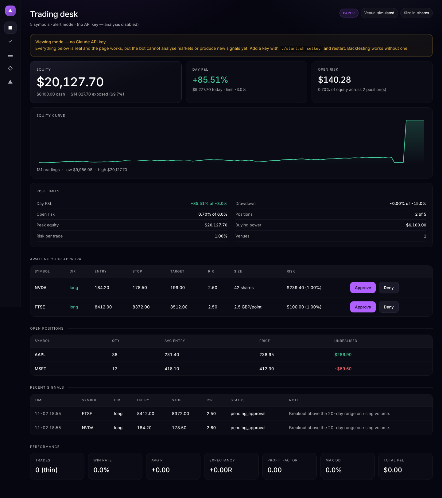

# AI Trading Bot

An AI-assisted trading system: it pulls in market data and news, sends them to
Claude for analysis, generates a trade idea **with a risk plan**, and — only if
you approve — routes it to a broker while alerting you on Discord or Telegram.

An always-on analyst that never sleeps, drafts the trade, and hands it to you.
You stay the trader.

> **Read this first — real-money risk.**
> Trading involves real risk of loss. AI models make mistakes and can be
> confidently wrong. Nothing here is financial advice. Never risk money you
> can't afford to lose. Start in paper mode and stay there until the system has
> proven itself over weeks. This is a tool, not a money printer.

---

## Architecture

```
Market Data ──► Indicators ──► News API ──► Claude ──► Signal Generation
                                                              │
                                                              ▼
                                                     Risk Management
                                                              │
                                        ┌─────────────────────┴──────────┐
                                        │                                │
                                   alert mode                       auto mode
                                        │                                │
                                 you approve  ────────────►  Broker API (Alpaca / IG)
                                        │                                │
                                        └──────────► Trade Execution ◄───┘
                                                              │
                                                    Journal ──┴──► Discord / Telegram
```

**The risk layer sits between the AI and the broker on purpose. The AI never
talks straight to your money — the risk rules are the gate.**

---

## What's in the box

| Piece | Where | What it does |
|---|---|---|
| Market data | `src/data/market_data.py` | Alpaca or IG bars, with a CSV provider for offline work |
| Indicators | `src/data/indicators.py` | SMA/EMA/RSI/ATR/MACD/Bollinger, pivots, trend |
| News | `src/data/news.py` | NewsAPI headlines, aggressively cached |
| Prompts | `src/ai/prompts.py` | The ten prompts, verbatim, plus JSON schemas |
| Analyst | `src/ai/analyst.py` | Chart + news → a setup, or explicitly no trade |
| Agent debate | `src/ai/debate.py` | Bull, bear and a risk manager who decides |
| Strategies | `strategies/` | Mechanical rules that pre-filter before any model call |
| Risk gate | `src/risk.py` | Hard limits — every rule is a reject, not a score |
| Sizing | `src/sizing.py` | Size from stop distance, never gut feel |
| Approvals | `src/approvals.py` | Human-in-the-loop queue, with expiry |
| Brokers | `src/broker/` | Alpaca (US shares), IG (UK spread bets), Trading 212 (shares/ISA), simulator |
| Portfolio | `src/portfolio.py` | One combined book across every venue — the risk rules see the whole thing |
| Execution | `src/execution.py` | Bracket orders; the only code that spends money |
| Journal | `src/journal.py` | SQLite record of signals, orders, trades, equity |
| Metrics | `src/metrics.py` | Win rate, avg R, expectancy, profit factor, max DD |
| Backtester | `src/backtest.py` | Replays the rules, with lookahead guards |
| Dashboard | `src/webhook_server.py` | Live P&L, positions, approve/deny, TradingView hook |
| Scheduler | `src/scheduler.py` | The 15-minute loop and the daily report |

---

## Quick start

### The one-command way (macOS / Linux)

```bash
git clone https://github.com/nigelguy007/Trading-bot.git
cd Trading-bot
./start.sh
```

`start.sh` creates the virtual environment, installs dependencies, creates
`.env` from the template on first run, and starts the dashboard at
**http://localhost:8001**. It works from any directory and is safe to re-run.

```bash
./start.sh doctor      # check the setup
./start.sh setkey      # paste your Anthropic key
./start.sh scan        # one pass over the watchlist
./start.sh backtest    # works with no API keys at all
./start.sh             # the dashboard
```

> Run these one per line. Don't paste a `#` comment onto the end of a command —
> macOS's zsh treats it as arguments, not a comment.

**Running from an external drive?** Use the full path under `/Volumes`, for
example `cd "/Volumes/My Drive/Trading-bot"`. Quote it if the drive name has a
space. If the drive is exFAT or FAT32 (the usual format for drives shared with
Windows) the launcher detects it and builds the virtual environment without
symlinks, which those filesystems can't store. If `./start.sh` is refused as
not executable, run `bash start.sh` instead.

> **`ModuleNotFoundError: No module named 'src'`** means you ran
> `python -m src.cli` from somewhere other than the project folder. Use
> `./start.sh`, which handles that for you, or `cd` into the repo first.

### The manual way

```bash
python3 -m venv venv
source venv/bin/activate          # Windows: venv\Scripts\activate
pip install -r requirements-trader.txt
cp .env.example .env
python -m src.cli serve           # must be run from the project root
```

Python 3.11+ is required.

### Configure

Add your Anthropic key:

```bash
./start.sh setkey
```

It prompts for the key and writes it into `.env` for you. (`.env` is a hidden
file, so if you'd rather edit it by hand, use `open -e .env` from Terminal —
Finder won't show it.) Any command that needs Claude will offer the same
prompt if no key is set yet.

The file is gitignored — **never commit it.** Leaked broker keys can drain a
real account.

| Service | Why | Where |
|---|---|---|
| Anthropic | The analysis brain | console.anthropic.com |
| Alpaca | Paper/live trades + market data | alpaca.markets → **use PAPER keys first** |
| IG (UK) | Spread bets + market data | ig.com → My IG → Settings → API keys. **Leveraged** — read [docs/ig-spread-betting.md](docs/ig-spread-betting.md) first |
| Trading 212 (UK) | Real shares, Invest/Stocks ISA | In-app → Settings → API (Beta). **No bracket orders** — read [docs/trading-212.md](docs/trading-212.md) first |
| NewsAPI | Headlines for context | newsapi.org |
| Discord | Trade alerts | Server Settings → Integrations → Webhook |
| Telegram | Trade alerts + approve/deny buttons | @BotFather → new bot → token |
| OpenRouter | Optional: one key, many models | openrouter.ai |

Set up a dedicated email and a fresh broker paper account just for this. It
keeps your keys, alerts and experiments separate from anything real.

Keys left as template placeholders (`your_paper_key`) are treated as **absent**,
not as real keys — so an unedited `.env` runs offline against the simulator
instead of failing with a 401. `doctor` tells you which are still placeholders.

### Which broker

`BROKER=auto` (the default) picks IG if IG keys are set, else Alpaca, else the
local simulator. Set it explicitly to pin one.

| | Alpaca | IG | Trading 212 |
|---|---|---|---|
| Available in the UK | Yes | Yes, a UK firm | Yes, a UK firm |
| What you trade | US shares + crypto | Spread bets / CFDs | Real shares and ETFs |
| Size is | A share count | A stake **per point** | A share count |
| Leverage | None | Always | None (Invest/ISA) |
| Stop attached to the entry | Yes | Yes, best of the three | **No** — placed after the fill |
| UK tax wrapper | No | Spread bets outside CGT | **Stocks ISA** |
| Symbols | `AAPL` | Epics (`UA.D.AAPL.CASH.IP`) | `AAPL_US_EQ` |
| Crypto | Yes | No | No |
| Its own price data | Yes | Yes, but rationed weekly | **None** — uses Alpaca |

Unleveraged is the safer first step, because the same mistake costs you less.
That means Alpaca or Trading 212. Each has one thing to read first:
**[docs/ig-spread-betting.md](docs/ig-spread-betting.md)** for IG's leverage, and
**[docs/trading-212.md](docs/trading-212.md)** for the fact that T212 cannot
attach a stop to an entry.

### Running two at once

`SECONDARY_BROKER` runs a second venue alongside the first, and the two are
treated as **one portfolio** — the daily stop, drawdown pause, position count
and correlation cap all apply to the combined book:

```
BROKER=ig
SECONDARY_BROKER=t212
BROKER_ROUTES=FTSE=ig,AAPL=t212
```

This matters more than it sounds. Run two bots instead and you get two
independent sets of limits: a -3% day at each venue is a -6% day that neither
daily stop ever saw. See **[docs/multi-broker.md](docs/multi-broker.md)**.

### Check the setup

```bash
./start.sh doctor              # offline checks
./start.sh doctor --check-apis # also makes one real call to each API
```

`doctor` catches the things that actually go wrong: a missing `.env`, keys with
trailing spaces, placeholder keys, a `.env` that isn't gitignored, missing
packages, and whether live trading is (correctly) still switched off.

### The dashboard



Equity, day P&L, drawdown, exposure and open risk at the top; pending signals
with Approve / Deny buttons; open positions; recent signals including the ones
the risk gate *rejected* and why; and running performance. It works on a phone
(`docs/dashboard-mobile.png`) so the approve/deny buttons are usable away from
your desk.

### No keys yet? Run the whole thing offline

```bash
./start.sh backtest --symbols AAPL,MSFT --bars 400
./start.sh scan --simulated
```

A local broker and CSV prices, so every stage runs without a single API key.
`python scripts/make_sample_data.py` generates the CSVs — the data is
**random**, so it proves the wiring works and says nothing whatsoever about any
strategy.

---

## Commands

| Command | What it does |
|---|---|
| `doctor` | Check the setup and diagnose problems |
| `scan` | One pass over the watchlist |
| `run` | The scheduled scan loop + daily report |
| `serve` | Dashboard and TradingView webhook |
| `backtest` | Replay the mechanical rules on past data |
| `analyze SYMBOL` | One-off AI market analysis and chart breakdown |
| `pending` / `approve` / `deny` | The human gate |
| `positions` / `close SYMBOL` | Account state and manual exits |
| `metrics` | Performance from the journal |
| `review` | AI review of closed trades — what you did wrong |
| `optimize STRATEGY` | AI review of a strategy's history |
| `portfolio-review` | AI read on concentration and correlation |
| `export` | Closed trades to CSV |
| `reset-drawdown` | Clear a drawdown pause, after you've reviewed it |

Useful flags: `--debate` (bull/bear/risk-manager, 3× the model calls),
`--always-analyse` (send every symbol to the AI, not just strategy triggers),
`--simulated` (fully offline).

---

## Risk management

This is the most important part. A mediocre strategy with great risk control
survives; a great strategy with no risk control blows up.

| Rule | Default | Setting |
|---|---|---|
| Risk per trade | ≤ 1% of account | `RISK_PER_TRADE_PCT` |
| Stop loss | Mandatory, set before entry | enforced in code |
| Daily loss limit | Stop trading at −3% | `DAILY_LOSS_LIMIT_PCT` |
| Max drawdown | Pause + review at −15% | `MAX_DRAWDOWN_PCT` |
| Position sizing | From stop distance | `src/sizing.py` |
| Correlated positions | Max 2 per group | `MAX_CORRELATED_POSITIONS` |
| Open positions | Max 5 | `MAX_OPEN_POSITIONS` |
| Total open risk | Max 6% | `MAX_PORTFOLIO_RISK_PCT` |
| Minimum R:R | 1.5 | `MIN_RISK_REWARD` |

A signal that fails **any** of these is rejected, logged with the reason, and
never reaches the broker. Rejections are journalled too — the daily report
tells you what got blocked and why, which is often more informative than the
trades that got through.

The drawdown pause survives restarts. Clearing it is a deliberate act
(`reset-drawdown`), because the point of the pause is that you review the
system before trading it again.

### Sizing, concretely

```
risk_dollars = equity × RISK_PER_TRADE_PCT / 100
shares       = risk_dollars / |entry − stop|
```

A wide stop gives a small position, a tight stop a larger one, and the dollar
loss if you're wrong is the same either way. Three caps sit on top (max
position size, buying power, whole shares for equities) and the alert tells you
which one bound.

> **Note the interaction:** a full-risk position needs notional of
> `risk% / stop-distance%`. At 1% risk, a 2% stop wants a position worth 50% of
> equity. If `MAX_POSITION_PCT` is tighter than that, tight-stop trades get
> trimmed and risk less than your configured 1%. That's safe, but it isn't what
> you set — the bot logs the threshold at startup and shows `capped_by` on every
> alert.

### The AI can be confidently wrong

The model will sometimes hand you a clean-looking setup that's garbage, and it
has no idea. That's why `EXECUTION_MODE=alert` is the default: signals become
*pending approvals*, not orders. You see the reasoning and the invalidation
levels, and you decide.

Approvals expire (`APPROVAL_TTL_MINUTES`, default 45). A setup that was clean
forty minutes ago usually isn't, and an approval sitting in a chat overnight is
a trap.

---

## Testing before going live

| Stage | What it proves | How |
|---|---|---|
| Backtesting | How the rules would have done on past data | `python -m src.cli backtest` |
| Paper trading | How it behaves live, with fake money | Alpaca paper keys, or an IG demo account |
| Forward testing | Real-time results over weeks, still on paper | `python -m src.cli run` |
| Metrics | Win rate, avg R, max drawdown, profit factor | `python -m src.cli metrics` |

The backtester tests the **mechanical rules only** — not the AI. You cannot
reproduce what a model would have said six months ago, and pretending otherwise
produces a number that means nothing. So the rules get backtested and the AI
layer gets forward-tested on paper.

It also guards the two classic ways a backtest lies to you: decisions use only
bars up to that point and fill at the *next* bar's open, and when a bar contains
both the stop and the target it assumes the stop hit first.

**Rule of thumb: paper-trade for at least a few weeks and 30+ trades before you
even think about live — then start with tiny size.** `metrics` and the daily
report both refuse to draw conclusions below 30 trades and say so explicitly.

If backtest results look too good, they're curve-fitted. Re-run on data the
rules weren't designed against.

---

## Going live

Live trading needs **three independent switches** to agree:

```bash
TRADING_MODE=live
ALPACA_PAPER=false
CONFIRM_LIVE=I_UNDERSTAND_THE_RISK
```

Flipping one by accident does nothing. `doctor` shows exactly which blockers
are still in place. Even then, `EXECUTION_MODE=alert` means nothing is ordered
without you tapping approve — full auto-execution is an advanced, higher-risk
mode. Earn it.

---

## TradingView integration

Point a TradingView alert webhook at `http://your-host:8001/webhook/tradingview`
with this message body:

```json
{"secret": "<TRADINGVIEW_WEBHOOK_SECRET>", "symbol": "{{ticker}}"}
```

A matching alert triggers analysis of that symbol. The endpoint is public by
nature, so the secret is mandatory, only watchlisted symbols are accepted, and
an alert can never place an order — it can only ask the bot to look.

## Telegram approve/deny from your phone

Set `TELEGRAM_BOT_TOKEN` and `TELEGRAM_CHAT_ID`, expose the server, and point
Telegram at it:

```python
from src.alerts.telegram import TelegramAlerts
TelegramAlerts(token, chat_id).set_webhook("https://your-host/webhook/telegram")
```

Signals then arrive with Approve / Deny buttons. Only your configured chat can
act on them.

---

## Advanced upgrades

Add one at a time and re-test after each — complexity is where bots quietly
break.

- **Multi-agent debate** (`--debate`) — a bull, a bear, and a risk manager who
  decides. A setup has to survive an adversary before it becomes a signal.
- **Portfolio dashboard** — `serve`, then open `http://localhost:8001`.
- **Mobile approve/deny** — Telegram buttons, above.
- **Multi-broker routing** — `BrokerRouter` routes by asset class. Set
  `BROKER=ig` for a UK spread betting account (IG Index / IG Markets); sizes
  then become a stake per point on **leveraged** positions, so read
  [docs/ig-spread-betting.md](docs/ig-spread-betting.md) before funding anything.
- **Sentiment / news as an input** — on by default when `NEWS_API_KEY` is set.
- **Crypto** — put Alpaca-style pairs in `CRYPTO_WATCHLIST` (e.g. `BTC/USD`).
  Note Alpaca has no bracket orders for crypto, so the stop is tracked bot-side
  only; the bot warns when this applies. IG has no crypto for UK retail clients
  at all, and refuses those signals rather than mis-routing them.
- **AI journaling** — `review` and `optimize` read your closed trades back to
  you and name the recurring mistake.

---

## Troubleshooting

| Problem | Fix |
|---|---|
| API errors / 401 | Wrong or expired key; check `.env` for trailing spaces. Run `doctor`. |
| Rate limits / 429 | Calling too fast — raise `SCAN_INTERVAL_MINUTES` or `NEWS_CACHE_TTL`, shorten the watchlist. |
| No signals firing | Filters too strict, or the market is flat. Try `--always-analyse` to bypass the mechanical pre-filter. |
| Install fails | Wrong Python version; use 3.11+ in a fresh venv. |
| Orders rejected (422) | Paper account not enabled, bad symbol format, or the market is closed. |
| IG: `error.security.api-key-invalid` | Demo and live IG keys are not interchangeable. Make `IG_DEMO` match the key you generated. |
| IG: `encryption.required` | Turn off "encrypted passwords" for that key in My IG → Settings → API keys. |
| IG: `error.security.invalid-details` | `IG_USERNAME` / `IG_PASSWORD` are your IG **web** login, not the API key. The username is case-sensitive. |
| IG: wrong market traded | A guessed epic. Pin it in `IG_EPICS` — `doctor --check-apis` shows what each symbol resolved to. |
| IG: `ATTACHED_ORDER_LEVEL_ERROR` | The stop is inside that market's minimum stop distance. `doctor --check-apis` prints it. |
| IG: price allowance exhausted | It is a **weekly** quota. Shorten `WATCHLIST` to 3-5 symbols and raise `SCAN_INTERVAL_MINUTES`. |
| IG: size refused as too small | A small account with a wide stop can't meet IG's minimum stake. The bot refuses rather than rounding up and over-risking. |
| T212: nothing to scan | Trading 212 has no price API. Add free Alpaca PAPER keys — they're used for DATA only. `doctor` fails on this. |
| T212: `broker.t212_UNPROTECTED_POSITIONS` | A position is open with no resting stop, from a crash between the entry and its stop. Place one in the app or close it. |
| T212: short signals skipped | Invest/ISA accounts are long only. Route shorts to IG or Alpaca, or filter them upstream. |
| Two brokers, limits feel wrong | Check `doctor` says "treated as ONE portfolio". Two separate bot instances do NOT share limits. |
| Strategy bug | Everything is logged to `logs/bot.jsonl`; test one piece at a time. |
| Fable 5 returns 400 | It requires 30-day data retention on your org. Set `CLAUDE_MODEL=claude-opus-5`. |
| Going live too fast | Back to paper. |

When something breaks, paste the exact error into Claude along with the
relevant code. It's the fastest debugger you have.

---

## Tests

```bash
pip install pytest
python -m pytest tests/ -q
```

334 tests, no network calls. They cover the parts where being wrong costs
money: sizing arithmetic (shares and spread-bet stakes), every risk rule, the
approval gate (including that alert mode really does order nothing and that a
double-tap can't double-order), journal R-multiples, backtest lookahead guards,
the IG wire format against a mocked IG — the deal/confirm sequence, the
never-resubmit-a-write rule, and the unconfirmed-deal case — the Trading 212
entry/stop/target sequence and its orphan-order reconciliation, combined risk
accounting across two venues (including that a -3% day at each really does
trip one -3% limit), and the full pipeline end-to-end against a stubbed model.

The Trading 212 request bodies are additionally checked against T212's own
OpenAPI document, vendored at `tests/fixtures/t212-openapi.json`, so a field
renamed upstream fails a test rather than an order.

---

## Also in this repo

`agents/`, `services/`, `backend/` and `frontend/` hold a separate
**prediction-market bot** (Polymarket/Kalshi) from earlier work — see
[docs/prediction-market-bot.md](docs/prediction-market-bot.md). It's an
independent system with its own dependencies in `requirements.txt`, unrelated
to the trading bot documented above.

---

## Disclaimer

Not financial advice. Trade at your own risk. Backtest results are not
predictions. The AI is an analyst, not an oracle, and you are the final check
on every signal it produces.
